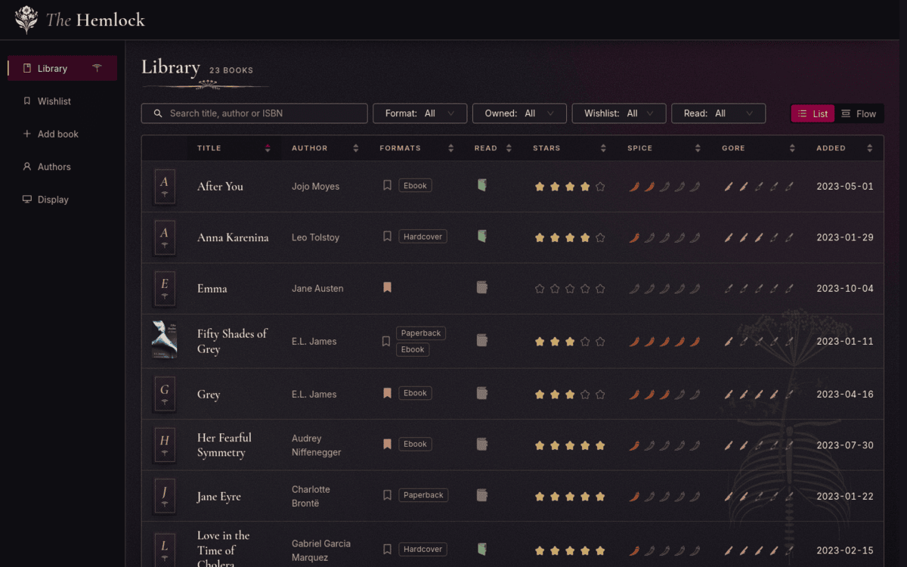
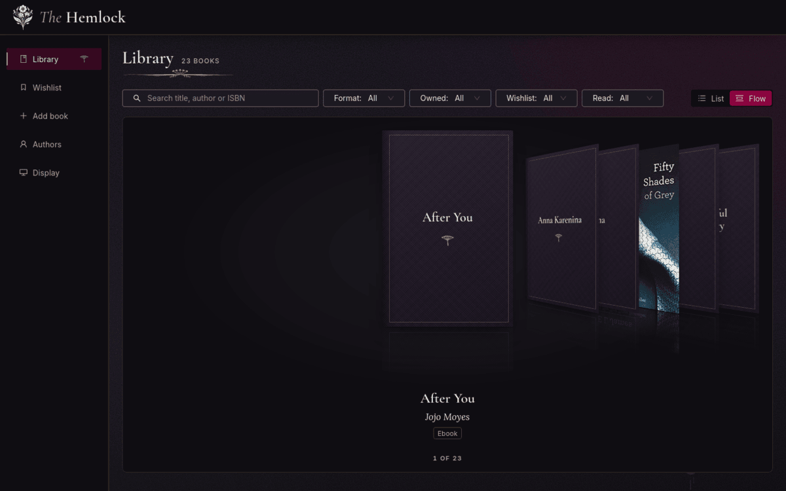
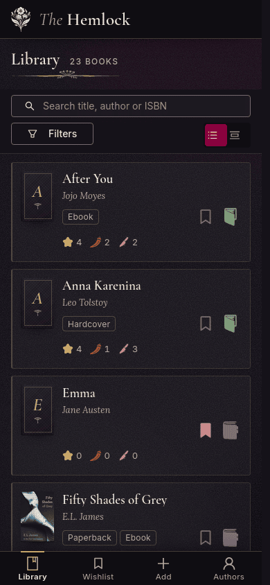

# Hemlock

Hemlock is a web application for cataloguing a personal book collection.
Inspired by the "BookTok" community's enthusiasm for dark romance novels and
named after the captivating yet toxic hemlock plant, it suits any genre of
literature. It is built for one household's library, on a phone first, with
a slideshow for the television.

## Dedication

Dedicated to my wife Chelsea, whose love for dark romance books breathed life
into this project. Your passion for reading and your support are the
foundation of Hemlock.







## Features

- **The library.** Every book with its author, synopsis, read status and
  three ratings out of five: stars, spice and gore. Search by title, author
  or ISBN; sort and filter by format, ownership, wishlist and read status.
- **Editions.** A book holds each copy the household owns, hardcover,
  paperback or ebook, with its ISBN, publisher, publication date and cover.
- **Wishlist.** A book can be on the wishlist before any copy is owned;
  marking it purchased adds the edition and takes it off the list.
- **Add by barcode.** Scan the barcode on the back cover with the phone's
  camera, or type the ISBN, and the title, author, publisher, synopsis and
  cover fill in from Open Library (and Google Books with a key).
- **Cover flow.** Browse the library as a row of covers, turned like an
  old music player, by wheel, drag, swipe or arrow keys.
- **TV display.** A full-screen slideshow of the library's covers at
  `/display`, with no navigation around it, for a television.
- **Phone first.** Every page works on a phone; the wide table becomes one
  column of cards.
- **Self-hosted.** One SQLite database and a directory of cover images,
  served by nginx and systemd on a small box behind the household's proxy.

## Running it

Requires Node 26.

```bash
git clone https://github.com/strachanbrad/hemlock.git
cd hemlock
npm install
npm run db:reset      # a dev library with sample books in data/
npm run dev           # http://localhost:5173
```

- **Development:** [wiki/dev-setup.md](wiki/dev-setup.md) covers the
  commands, the configuration and testing the scanner on a phone.
- **Deployment:** [wiki/deployment.md](wiki/deployment.md) covers installing
  Hemlock on a Debian box with nginx and systemd, backups and restore.

The rest of the documentation starts at [wiki/README.md](wiki/README.md).

## License

Hemlock is released under the GPL-3.0 license. See the LICENSE file for more
details.
